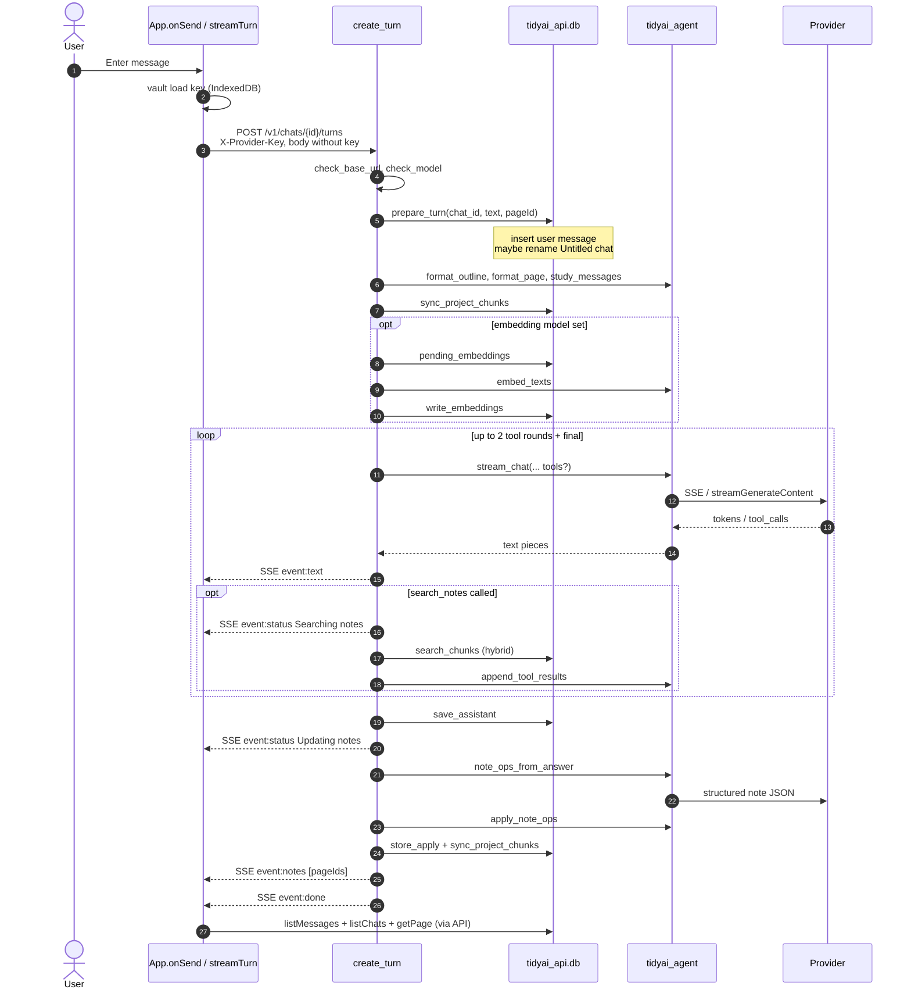
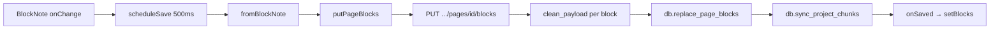
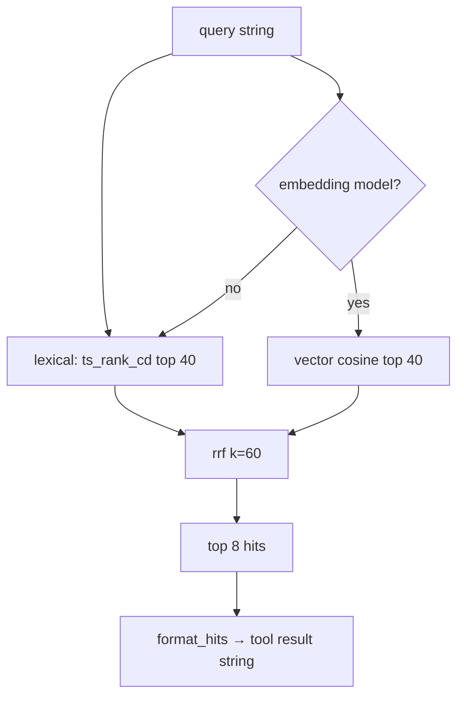

# tidyai — system architecture

Date: 2026-11-07. This document describes the system **as implemented**. Decision history and rejected options live in `docs/research/`. Runtime rules for agents live in `AGENTS.md`.

## 1. Product shape

tidyai is a local BYOK study workspace.

| Concept | Meaning |
| --- | --- |
| **Project** | One subject (course / topic). Owns the note tree and chats. |
| **Chat** | One study session inside a project. Message log only. |
| **Page / block** | Nested note tree. Typed blocks with stable ids. Source of truth for what was learned. |
| **Turn** | One user message → streamed assistant answer → optional note ops. |

The UI is three panes: subject/chat sidebar, chat column, notes notebook. Provider keys stay in the browser vault; the API never stores them.

## 2. Runtime processes

Four processes on the operator’s machine:

```text
┌─────────────────┐     ┌──────────────────┐     ┌─────────────────────┐
│  apps/web       │     │  services/api    │     │  Provider (BYOK)    │
│  Vite + React   │────▶│  FastAPI/uvicorn │────▶│  OpenAI-compat or   │
│  :5173          │ SSE │  :8000           │     │  Gemini             │
└─────────────────┘     └────────┬─────────┘     └─────────────────────┘
                                 │
                                 │ SQL (psycopg)
                                 ▼
                        ┌──────────────────┐
                        │  Postgres 17     │
                        │  + pgvector      │
                        │  127.0.0.1:5434  │
                        │  docker compose  │
                        └──────────────────┘
```

| Process | How to start | Port | Owns |
| --- | --- | --- | --- |
| Postgres | `docker compose up -d` | `127.0.0.1:5434` | Rows, `tsvector`, HNSW vectors |
| API | `uvicorn tidyai_api.main:app --reload --port 8000` | `8000` | HTTP, SSE, transactions, schema apply |
| Web | `npm run dev` (Vite) | `5173` | Panes, vault, Streamdown, BlockNote |
| Provider | External / local model | varies | Token generation, optional embeddings |

`services/agent` is **not** a separate process. It is a Python package imported by the API. Pure functions: prompts, streaming clients, note-op validation. No FastAPI, no SQL.

## 3. Tech stack

### Web (`apps/web`)

| Piece | Choice | Role |
| --- | --- | --- |
| Bundler | Vite 6 | Dev server + build |
| UI | React 19 + TypeScript | Shell and panes |
| Styling | Tailwind CSS v4 + local shadcn-style primitives | Warm Slate tokens in `globals.css` |
| Chat markdown | Streamdown + `@streamdown/math` + KaTeX | Streaming GFM + formulas |
| Notes editor | BlockNote (`@blocknote/core`, `react`, `shadcn`) | Notion-like notebook UX |
| Icons | lucide-react | Chrome and block affordances |
| Key vault | WebCrypto + IndexedDB + `localStorage` ciphertext | Non-extractable vault key; profiles encrypted |

### API (`services/api`)

| Piece | Choice | Role |
| --- | --- | --- |
| Framework | FastAPI | Routes, Pydantic bodies, SSE |
| DB driver | psycopg 3 async | Parameterized SQL only |
| Schema | `schema.sql` (idempotent) | Applied on startup via `init_schema` |
| Contract | `contracts/openapi.yaml` | Live route surface |

### Agent (`services/agent`)

| Piece | Choice | Role |
| --- | --- | --- |
| HTTP client | httpx | Provider stream + embed (`follow_redirects=False`) |
| Protocols | `openai_chat`, `gemini` | Settings-driven hosts |
| Policy | Plain Python | Route cues, block allowlist, RRF constants |

### Data

| Piece | Choice | Role |
| --- | --- | --- |
| Engine | Postgres 17 (`pgvector/pgvector:pg17`) | Single store |
| Lexical | `tsvector` / `ts_rank_cd` | Keyword search |
| Vector | `vector(1536)` + HNSW | Optional embeddings |
| Fusion | Reciprocal Rank Fusion, `k = 60` | Hybrid merge |

## 4. Module boundaries

```text
apps/web  ──HTTP/SSE──▶  services/api  ──calls──▶  services/agent
                              │
                              └──SQL──▶  Postgres
```

| Module | May | Must not |
| --- | --- | --- |
| `apps/web` | Panes, vault, Streamdown, BlockNote, mapper | Ranking, SQL, key in JSON body |
| `services/api` | HTTP, transactions, SQL, call agent fns | Prompt text, provider URL assembly |
| `services/agent` | Prompts, stream, note-op checks, chunk math | FastAPI, psycopg, env secrets |

`ProviderError` is the only failure type the API surfaces from provider calls. Keys never appear in SSE payloads, logs, or turn JSON.

## 5. Data model

```text
projects 1──* chats 1──* messages
    │
    └──* pages (tree via parent_id, depth ≤ auto-create cap in agent)
           └──* blocks (ordered, typed, versioned)
chunks (project-scoped search rows from blocks + user messages)
```

| Table | Key columns | Notes |
| --- | --- | --- |
| `projects` | `id`, `title` | Subject |
| `chats` | `project_id`, `title` | Default title `Untitled chat`; renamed on first turn |
| `messages` | `chat_id`, `role`, `content` | `user` \| `assistant` |
| `pages` | `project_id`, `parent_id`, `title`, `depth`, `position` | Note tree |
| `blocks` | `page_id`, `position`, `type`, `payload`, `version` | Typed JSON payload |
| `chunks` | `source_type`, `source_id`, `content`, `tsv`, `embedding` | Search index |

**Block types** (agent allowlist in `tidyai_agent.turn.BLOCK_TYPES`):  
`paragraph`, `heading`, `bulleted_list_item`, `numbered_list_item`, `to_do`, `equation`, `table`, `callout`, `toggle`, `divider`, `child_page`.

Flashcard tables (`cards`, `reviews`) are specified in research and **not built**.

## 6. Constants and ceilings (metrics)

These are product ceilings, not monitored APM metrics. Change only with evidence (see research files).

| Name | Value | Where | Meaning |
| --- | --- | --- | --- |
| Chat column max width | 768px | UI | Reading column |
| Sidebar | 260px / rail 56px | UI | Nav |
| Notes default width | 360px (280–640) | `notes-width.ts` | Drag-resizable |
| Notes overlay breakpoint | 960px | UI | Overlay under this width |
| Panel open / close | 250ms / 200ms | UI | Motion |
| `search_notes` max rounds | 2 tool rounds, then stream without tools | `create_turn` loop `range(3)` | Cap tool cost |
| Tool calls per round | 1 (`search_notes` only) | `create_turn` | No tool fan-out |
| RRF `k` | 60 | `retrieve.RRF_K` | Fusion constant |
| Lexical / vector candidates | 40 each | `db.search_chunks` | Pool before fusion |
| Search return size | 8 hits | `db.search_chunks` | Prompt budget |
| Embedding dim | 1536 | `retrieve.EMBEDDING_DIM` | Column width |
| Chunk size | 4000 chars, max 8 parts | `retrieve.MAX_CHUNK` / `MAX_PARTS` | Index granularity |
| Pending embed batch | 32 | `_embed_pending` | Per-turn backfill |
| Note ops per turn | ≤ 20 | `apply_note_ops` | Prevent full-tree thrash |
| Page blocks PUT max | 500 | `PageBlocksIn` | Human notebook save |
| Autosave debounce | 500ms | `NotesEditor` | No Save button |
| Untitled titles | `Untitled chat`, legacy `New session` | `prepare_turn` | Rename from first user line |
| Same-concept cosine | 0.92 | `turn.SAME_CONCEPT_COSINE` | Cards (not built yet) |
| Body contrast | ≥ 4.5:1 | Design | Do not lighten `--muted` |

**Health check:** `GET /health` → `{ status, db: "ok"|"down" }`.

## 7. End-to-end: study turn

### 7.1 Sequence diagram



### 7.2 Step → function map

| Step | Function(s) | Process |
| --- | --- | --- |
| 1. User sends | `App.onSend` | Web |
| 2. Build request | `streamTurn` (`api.ts`) | Web |
| 3. Authn of key presence | `create_turn` header check | API |
| 4. Validate host/model | `check_base_url`, `check_model` | Agent |
| 5. Persist user turn | `db.prepare_turn` | API → Postgres |
| 6. Prompt assembly | `format_outline`, `format_page`, `study_messages` (+ `TOOL_HINT`) | Agent |
| 7. Index refresh | `db.sync_project_chunks` | API → Postgres |
| 8. Optional embed backfill | `_embed_pending` → `pending_embeddings` → `embed_texts` → `write_embeddings` | API + Agent |
| 9. Stream answer | `stream_chat` (+ `ToolAssembler`) | Agent → Provider |
| 10. Relay tokens | `sse("text", …)` | API → Web |
| 11. Tool (optional) | `_run_search` → `db.search_chunks` → `rrf` / `format_hits` → `append_tool_results` | API + Agent + Postgres |
| 12. Save assistant | `db.save_assistant` | API → Postgres |
| 13. Note ops | `note_ops_from_answer` → `parse_ops_payload` / repair | Agent → Provider |
| 14. Validate + apply in memory | `apply_note_ops` / `clean_payload` / `validate_note_op` | Agent |
| 15. Commit notes | `db.store_apply` | API → Postgres |
| 16. Re-index | `db.sync_project_chunks` | API → Postgres |
| 17. Client refresh | SSE `notes` → `App.refreshNotes` → `getPage` | Web |
| 18. Title refresh | `listChats` after turn | Web |

### 7.3 SSE event types

| Event | Payload | Client action |
| --- | --- | --- |
| `text` | raw token string | Append to streaming bubble (`Streamdown`) |
| `status` | human string | Badge / status line |
| `notes` | JSON array of page ids | Refetch pages; if notes dirty → Reload banner |
| `error` | `{ code, message }` | Show error; key never included |
| `done` | `{}` | End stream |

## 8. End-to-end: human notes edit (BlockNote)



| Step | Function(s) |
| --- | --- |
| Load | `getPage` → `toBlockNote` → `useCreateBlockNote` |
| Edit | BlockNote document (slash, drag, tables, …) |
| Map out | `fromBlockNote` (`block-mapper.ts`) |
| Save | `putPageBlocks` → `put_page_blocks` → `replace_page_blocks` |
| Conflict with model | If `notesDirty`, show Reload; else bump `notesRevision` |

Custom BlockNote types: `equation`, `child_page`. Mapped pairs: callout↔`quote`, toggle↔`toggleListItem`.

## 9. Retrieval (hybrid search)



| Step | Function |
| --- | --- |
| Chunk build | `block_source`, `chunk_text`, `chunks_for_source` inside `sync_project_chunks` |
| Lexical + vector SQL | `db.search_chunks` |
| Fusion | `rrf` |
| Prompt text | `format_hits` |

Missing embedding model → keyword only. Wrong embedding dimensionality → vector path skipped / null vectors.

## 10. BYOK / security path

```text
Settings profile
  → vault.encrypt (WebCrypto, non-extractable key in IndexedDB)
  → ciphertext in localStorage
  → onSend: decrypt in memory
  → streamTurn sets X-Provider-Key / optional X-Embedding-Key
  → API uses header for one turn, does not persist
  → stream.py: follow_redirects=False; redact() strips sk-… / AIza…
  → check_base_url: http(s) only, no userinfo; localhost allowed for local models
```

Turn JSON must never contain the key. Accounts are out of scope while base URL is client-supplied (SSRF risk if combined with server-side auth).

## 11. Web component map

| Area | Entry | Notes |
| --- | --- | --- |
| Boot | `main.tsx` → `App` | Theme class on `<html>` |
| Shell | `App.tsx` | Sidebar tree, chat, notes width, SSE handlers |
| Chat render | Streamdown in `App` | No `dangerouslySetInnerHTML` for model HTML |
| Notes | `NotesEditor` + `notes-schema` | Autosave status Ready/Editing/Saved |
| Mapper | `lib/block-mapper.ts` | tidyai ↔ BlockNote |
| Settings | `Settings.tsx` | Profiles, protocol, embed fields |
| Vault | `vault.ts` | load/save profiles, active id |

## 12. API route map

| Method | Path | Handler |
| --- | --- | --- |
| GET | `/health` | `health` |
| GET/POST | `/v1/projects` | `projects` / `create_project` |
| GET/POST | `/v1/projects/{id}/chats` | `chats` / `create_chat` |
| GET | `/v1/chats/{id}/messages` | `messages` |
| GET | `/v1/projects/{id}/pages` | `pages` |
| GET | `/v1/projects/{id}/pages/{pageId}` | `page` |
| PUT | `/v1/projects/{id}/pages/{pageId}/blocks` | `put_page_blocks` |
| PATCH | `/v1/blocks/{id}` | `patch_block` |
| POST | `/v1/chats/{id}/turns` | `create_turn` (SSE) |

Schema bootstrap: `lifespan` → `db.init_schema()` reading `schema.sql`.

## 13. Agent package map

| Module | Responsibility |
| --- | --- |
| `turn.py` | `route_turn`, `validate_note_op`, `BLOCK_TYPES`, card cosine constant |
| `notes.py` | Prompts, `apply_note_ops`, `note_ops_from_answer`, `clean_payload` |
| `stream.py` | `stream_chat`, `complete_chat`, `embed_texts`, URL/model checks, redact |
| `retrieve.py` | Chunking, RRF, `SEARCH_TOOLS`, `ToolAssembler`, `format_hits` |

`route_turn` exists for cue-based routing research; the live turn path currently lets the model call `search_notes` via tools instead of a hard pre-route gate.

## 14. What is not in the system (yet)

| Feature | Status |
| --- | --- |
| Flashcards / FSRS | Specced in research 03; no tables/UI |
| Accounts / multi-user | Explicitly out |
| Separate vector DB | Rejected; Postgres only |
| Reranker / LangGraph | Rejected ceilings |
| Third provider wire protocol | Only `openai_chat` and `gemini` |
| Alembic | No; `schema.sql` only |

## 15. Verify commands

| Change | Command |
| --- | --- |
| Agent | `cd services/agent && PYTHONPATH=src python3 -m unittest discover -s tests -v` |
| API turn + notes PUT | `cd services/api && .venv/bin/python -m unittest tests.test_turn_flow -v` |
| Web types | `cd apps/web && npx tsc --noEmit` |
| Manual | Open `:5173`, send a turn, confirm notes update and key never appears in Network JSON |

## 16. Related docs

| Doc | Role |
| --- | --- |
| `AGENTS.md` | Binding rules for implementers |
| `docs/research/01`–`10` | Why each decision was locked |
| `contracts/openapi.yaml` | HTTP/SSE contract |
| This file | How the running system fits together |
